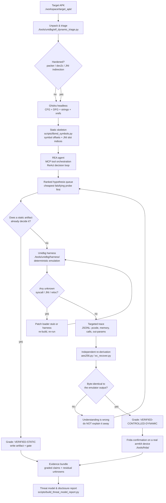
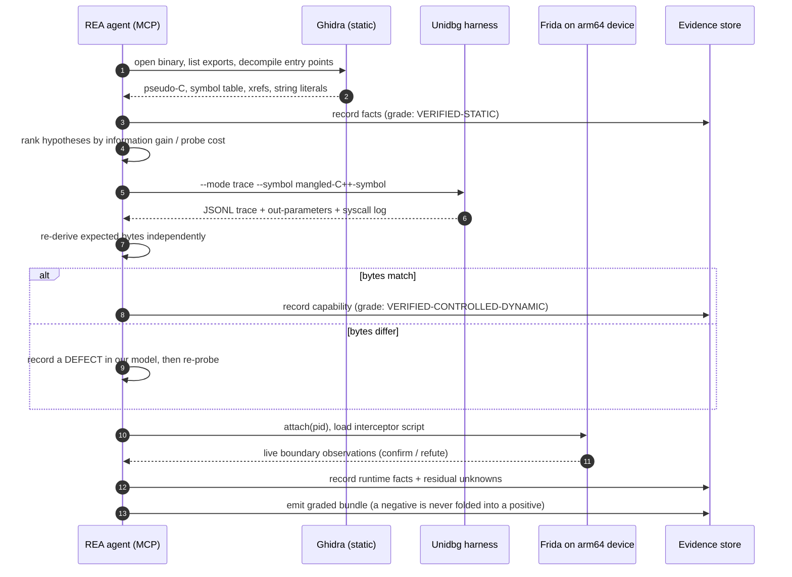
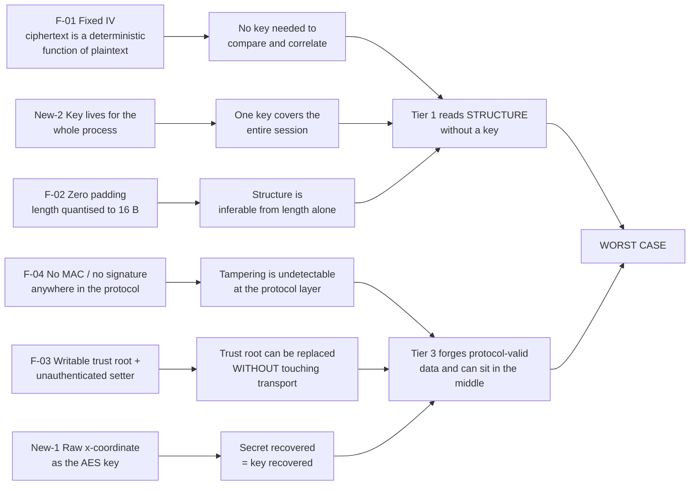

<div align="center">

# AutoRev-Crypto

**A multimodal-agent + deterministic-emulation framework for automated, reproducible
reverse engineering of hardened Android applications**

[](LICENSE)
[](#5-toolchain--scripts)
[](#5-toolchain--scripts)
[](#5-toolchain--scripts)
[](#5-toolchain--scripts)
[](#5-toolchain--scripts)
[](#5-toolchain--scripts)
[](#13-determinism-is-the-product)

</div>

---

> ## Responsible Disclosure Notice
>
> This repository documents a **research methodology**, not an attack toolkit.
>
> * **No live service was ever contacted.** During the entire study the emulated process created
>   **zero sockets** (`socket`/`connect`/`send`/`recv` observation count `0`). No packet left the
>   research host. No client-server session was established, keyed, or broken.
> * **No real session key was captured.** The per-session secret is regenerated inside the process
>   by the platform RNG on every run. It exists only in runtime memory and is an **input** to these
>   tools — never an output that this project harvests from a live target.
> * **No exploit code is published here.** There is no memory-corruption primitive, no
>   privilege-escalation payload, no code-execution gadget, and no remote-triggerable defect. Every
>   finding is a *cryptographic-misuse* or *hardening-depth* observation.
> * **The affected vendor was engaged first.** Findings were reported through a private,
>   access-controlled disclosure document that preceded this public write-up. This repository is the
>   sanitized methodological companion to that report.
> * **Everything is identified abstractly.** The target is only ever `Target Application`;
>   identifiers are renamed; absolute paths are replaced with `$PROJECT_ROOT`-relative paths;
>   content hashes are replaced with format-preserving placeholders. The concrete cryptographic
>   constants that would fingerprint the exact build are deliberately **not** published (see
>   [§8.2](#82-why-the-cryptographic-constants-are-placeholders)).

---

## Table of Contents

| § | Section |
| --- | --- |
| 1 | [Introduction](#1-introduction) |
| 2 | [Automated Pipeline & Toolchain](#2-automated-pipeline--toolchain) |
| 3 | [Key Breakthroughs](#3-key-breakthroughs-from-environment-isolation-to-cryptographic-closure) |
| 4 | [Threat Modeling from the Adversary's Perspective](#4-threat-modeling-from-the-adversarys-perspective) |
| 5 | [Toolchain & Scripts](#5-toolchain--scripts) |
| 6 | [Future Work: AI & Data Science](#6-future-work-ai--data-science) |
| 7 | [Appendix](#7-appendix) |
| 8 | [License, Scope & Disclaimers](#8-license-scope--disclaimers) |

---

## 1. Introduction

### 1.1 The problem: hardening has outrun the manual workflow

Modern Android protection stacks have collapsed the economics of hand-driven reverse engineering.
A typical high-value target now ships behind three independent layers at once:

| Layer | Mechanism | What it breaks |
| --- | --- | --- |
| **Packer / loader** | A commercial 360-series VIP packer (`libjiagu_vip_a64.so`) that decrypts its real payload at runtime, registers JNI methods indirectly, and fingerprints the framework before doing anything | Static tooling sees a trampoline, not the program |
| **AOT-to-native compilation** | DTC (dex2c) — the application's own Java methods are compiled to native and **no longer exist as ART methods** | Java-layer hooking silently observes nothing |
| **Native Bridge isolation** | On an `x86_64` emulator, the app's `arm64-v8a` libraries execute inside the libnb translation cache under `/system/lib64/arm64/nb/*` | Frida interceptors on those addresses land on *data*, not code |

The third failure mode is the most deceptive, because **every tool reports success while returning
nothing**. In this study, 21 framework hooks (EditText, `okhttp3`, Telephony, Wifi, Settings,
AccountManager, Location, SharedPreferences, MessageDigest, Mac, …) installed without error and
produced **zero calls** during a genuine login-form interaction. Activity-lifecycle hooks never
fired. A runtime class census found 14,460 loaded classes, of which only **6** were
application-related — while the app's own launcher activity was absent from the ART table entirely.

The lesson generalises: **"the hook installed" is not evidence, and "the tool exited 0" is not
evidence.** Under a hardening stack, the dominant failure mode is the *silent* one.

### 1.2 The thesis: replace single-point breakthroughs with a contract

This project replaces the ad-hoc loop with an explicit contract:

> Every claim must be traceable to an artifact that measured it, produced by a tool that can be
> re-run to produce it again.

That contract drives four design decisions:

1. **Deterministic execution over opportunistic observation.** Emulation (Unidbg) is the primary
   instrument, because the same input reproduces the same trace byte-for-byte. Device-side
   instrumentation (Frida) is used to *confirm* what emulation predicts — not to discover it.
2. **Format-level re-derivation instead of tool trust.** Cryptographic results are recomputed
   *outside* the emulator with independent primitives (`aes256.py`, `ec_recover.py`) and compared
   byte-for-byte against what the target's own code returned. A match is a **construction proof**;
   a mismatch is a defect in our understanding, not a rounding error to be explained away.
3. **An evidence grade on every statement.** Findings carry an explicit grade
   ([§4.1](#41-evidence-grading)) plus a *conclusion boundary* stating what is **not** claimed.
   "Theoretically reachable" and "demonstrated under controlled replay" are never conflated.
4. **Fail-closed gates.** Every stage ends with an executable verifier that re-reads every artifact
   the stage's conclusions rest on, and exits non-zero on a missing or contradictory one.

### 1.3 Determinism is the product

The deliverable is not a pile of findings — it is the ability to **reproduce** them. Concretely:

| Guarantee | How it is enforced |
| --- | --- |
| Emulation is deterministic | The harness deep-copies the module image and re-runs the same call sequence; `t1_selftest_byte_identical.json` records a byte-identical re-run |
| Key generation is per-run, not per-install | `t1_pubkey_determinism.json` records two runs of the same entry point producing **two different** public points — an *observed* fact, not an assumption |
| Crypto correctness is independently checkable | `aes256.py` asserts the FIPS-197 Appendix C.3 known answer at import time; `ec_recover.py` self-tests curve arithmetic on import |
| Conclusions are gated | `_verify_deliverables.py` re-reads every artifact a capability rests on; `verify_e2e_capabilities.py` exits `2` if any capability is not `PROVEN` |

### 1.4 Scope and compliance

| Dimension | Measured in this study | Explicitly out of scope |
| --- | --- | --- |
| **Runtime** | Controlled emulation + one rooted `arm64-v8a` device; no production traffic | Production service interaction |
| **Cryptography** | Construction correctness, key-derivation mode, protocol structure | Server-side acceptance of any request |
| **Transport** | Not evaluated | TLS version/suite, certificate-pinning policy |
| **Server** | Not evaluated | Authn/authz, session management, risk-scoring logic |
| **Data at rest** | Not evaluated | Local databases, caches, logs, crash dumps |

Declaring the last three rows *not evaluated* is deliberate. A threat model that asserts a
transport-layer weakness it never measured — and then builds a kill chain on it — is not a threat
model, it is a liability. Every scenario in [§4](#4-threat-modeling-from-the-adversarys-perspective)
is therefore built **only** on layers that were actually measured.

---

## 2. Automated Pipeline & Toolchain

### 2.1 The pipeline at a glance



### 2.2 Data flow versus decision flow

The diagram above mixes two different graphs on purpose, so they are worth separating explicitly:

| Graph | Nodes | Purpose |
| --- | --- | --- |
| **Data flow** | Ghidra → static skeleton → Unidbg harness → trace JSONL → independent re-derivation → evidence bundle | Carries **bytes**. Every edge is a file on disk with a recorded digest. |
| **Decision flow** | static skeleton → REA hypothesis queue → probe selection → grade → next probe | Carries **questions**. Every edge is "the cheapest probe that could falsify this claim". |

Keeping them apart is what stops the pipeline from degenerating into "run every tool, then narrate
whatever came back". A probe is only scheduled when its *answer* would change a grade.



### 2.3 The four frameworks, and what each one is actually for

#### 2.3.1 Ghidra — the static graph extractor

Role: turn a native module into a **typed, navigable graph** before a single byte is executed.

* **CFG/DFG extraction.** Function boundaries, basic blocks and data-flow edges — the input to every
  "where does this pointer come from?" question.
* **Shell entry discovery.** Packer analysis located `JNI_OnLoad` (a deliberately short obfuscated
  trampoline) alongside the packer's own crypto helper, producing the *static* addresses that later
  become runtime breakpoints.
* **Cross-verification of names.** Names recovered from `.dynsym` and names produced by the
  decompiler are cross-checked against the string literals the code actually loads, so no name is
  ever trusted on the strength of a single source.

**Why Ghidra first, but not alone:** a CFG tells you *what the code can do*, never *which of those
paths the target actually took*. That gap is the whole reason Unidbg exists in this pipeline.

#### 2.3.2 REA — the agentic scaffold (the "strategy prior")

Role: serve as the **cognitive scaffold** for an LLM agent driving the toolchain over MCP, so the
pipeline can branch autonomously instead of following a fixed script.

* **Tool orchestration over MCP.** Static, dynamic and emulation operations are exposed as
  first-class tools returning structured evidence rather than prose.
* **ReAct-style decision making.** Each turn is Observe → Reason → Act: read the newest artifact,
  re-rank the hypothesis queue, choose the next probe, record the outcome, loop.
* **Bounded by construction.** The agent's *authority* is deliberately limited. It can read bytes,
  resolve symbol names, decompile a function, trace a value graph — it cannot invent a conclusion.
  Every claim it emits must cite an artifact with a digest. That constraint is what makes an
  agent-driven pipeline **auditable** instead of merely fast.

**Why this is a methodology point, not a convenience:** the expensive part of reverse engineering is
not running tools, it is *deciding what to run next*. Encoding that decision as an explicit,
reviewable loop is the difference between automation and a random walk.

#### 2.3.3 Frida — the high-dimensional dynamic probe

Role: confirm emulation-derived predictions against a **real running process**, and supply the one
thing emulation cannot: reality.

Two hard constraints shaped the whole design:

1. **Native Bridge isolation.** On the `x86_64` emulator the app's ARM libraries execute inside
   libnb's translation cache, so their instruction bodies are not host-executable addresses and
   cannot be intercepted. The only host-executable surface is the ART `x86_64` `JNIEnv` function
   table that every guest JNI call is forwarded through — so that became the observation point.
2. **`spawn` is unavailable.** A freshly spawned process dies with a `SIGSEGV` null-deref even with
   a no-op script attached. All device work is therefore `attach`-only, and the capture window opens
   *after* the app is already running.

From those constraints the tooling implements **address-based hooking** and **caller tracing**
instead of the conventional slot-based approach — see
[§3.3](#33-engineering-note-why-address-based-hooks-instead-of-slot-based-hooks).

#### 2.3.4 Unidbg — the deterministic emulation engine (centre of gravity)

Role: execute the target's own native code with no device, no root, no network, and full
observability.

The value is not "it runs code". The value is that it makes **the target's own implementation the
oracle**, while every input stays under experimental control:

| Capability | Implementation |
| --- | --- |
| **Targeted function-level trace** | Code/read/write hooks scoped to one symbol's address range with bounded step budgets — so a multi-megabyte module yields a *reviewable* trace instead of an unreadable one |
| **Syscall interception** | Unimplemented syscalls are substituted with recorded stubs, and the substitutions themselves are logged as evidence, so an emulated value can never be mistaken for an observation |
| **C++ ABI parsing** | A `std::string` returned **by value** is not a pointer: it arrives through a hidden by-value return slot. Read it wrong and the trace silently loses the entire result |
| **64-bit relocation handling** | Required a genuine bug fix in the vendored ELF parser — see [§2.4](#24-spotlight-fixing-a-64-bit-relocation-bug-in-the-vendored-jelf-parser) |

### 2.4 Spotlight: fixing a 64-bit relocation bug in the vendored `jelf` parser

This is the single most instructive episode in the project, because the symptom pointed at the
*sample* and the cause was in *our own loader*.

#### The symptom

The first attempt to load the packer library into the emulator **hung inside `loadLibrary`** and
emitted **exactly 262** warnings:

```text
Unhandled relocation type 0
```

262 is a suspiciously precise number. Static triage of the shipped packer library, read straight
out of `PT_DYNAMIC`, said:

| Table | `DT_*` size | Entry size | Entries |
| --- | --- | --- | --- |
| `.rela.dyn` (`DT_RELA` / `DT_RELASZ` / `DT_RELAENT`) | `size = 0xCC0` | 24 | **136** (107 `RELATIVE`, 20 `ABS64`, 9 `GLOB_DAT`) |
| `.rela.plt` (`DT_JMPREL` / `DT_PLTRELSZ`) | `size = 0xBD0` | 24 | **126** (`JUMP_SLOT`) |

136 + 126 = **262**. The warning count equalled the *total relocation count*, i.e. the loader had
failed on **every single relocation** — which is exactly why `JNI_OnLoad` never ran and the module
could never have called `memcpy`, `mprotect` or `sysconf`.

#### Isolating the cause: `R_AARCH64_NONE` or a misread table?

The decisive question was whether these really were 262 legitimate `R_AARCH64_NONE` entries (which a
loader is entitled to skip) or whether the loader was reading the **wrong table geometry**. A
throwaway dumper (`_recon_reloc.py`) answered it from the shipped bytes: it unbundled each record
using the ELF64 rule `ELF64_R_SYM(i) = i >> 32`, `ELF64_R_TYPE(i) = i & 0xFFFFFFFF`, and printed the
relocation-type histogram. The dump showed clean `RELATIVE` / `ABS64` / `GLOB_DAT` / `JUMP_SLOT`
records — **no `NONE` entries at all**. The table was fine. The loader was misreading it.

#### Root cause

```java
// net/fornwall/jelf/ElfDynamicStructure.java:172   (before the fix)
relEntrySize = elfFile.arch == ElfFile.CLASS_64 ? 24 : 12;
```

`ElfFile.arch` holds **`e_machine`**, not ELF class. It is assigned from `parser.readShort()`, so for
AArch64 it is **183**. `ElfFile.CLASS_64` is **2**. The comparison `183 == 2` is false, so **every
64-bit object silently fell back to 12-byte relocation entries.**

The arithmetic then explains the exact warning count:

* `rel  = 3264 / 12 = 272`
* `plt  = 3024 / 12 = 252`
* total records read at a 12-byte stride: **524**

At that stride the **even** indices land precisely on real 24-byte boundaries and decode correctly.
The **odd** indices start 12 bytes into a record, so `r_info` is read out of the middle of the
structure — producing `0x000217b800000000`-shaped garbage whose low 32 bits are `0`.
`ELF64_R_TYPE(garbage) == 0`, so the type reads as `NONE` and the entry is skipped. Half of 524 is
**262** — precisely the number of warnings observed.

Two corroborating facts removed all doubt:

* `_recon_reloc.py` was the *only* site in `jelf` comparing against `arch`; every sibling code path
  uses `objectSize` (`ElfRelocation`, `ElfSegment`, `ElfSymbol`, `ElfGnuHashTable`, `ElfInitArray`,
  `ElfParser`) — i.e. the site was an outlier, not a deliberate convention.
* A repository-wide search found the `Unhandled relocation type 0` warning in **no** prior log.
  Our earlier module loads had all been single-`PT_LOAD`-style layouts that never exercised this
  path, so the bug was dormant until a genuinely packed, multi-segment library arrived.

#### The fix

One token, plus a comment recording the failure mode:

```diff
- relEntrySize = elfFile.arch == ElfFile.CLASS_64 ? 24 : 12;
+ relEntrySize = elfFile.objectSize == ElfFile.CLASS_64 ? 24 : 12;
```

Rebuilt and re-installed the affected module, then re-ran the harness. Result:

* relocation warnings: **gone**;
* `JNI_OnLoad` now **executes** (`module base + statically measured offset`) — the packer's
  registration path became observable for the first time.

#### Why this belongs in a methodology README

The bug is a textbook **type-confusion between two unrelated ELF header fields** (`e_machine` versus
`EI_CLASS`) that produces *silently wrong* results in the majority of cases and *correct* results by
coincidence at even indices. That combination is the most dangerous kind:

* it does not crash;
* it does not log an error the loader's author would recognise;
* it produces a plausible-looking partial success;
* and it fails in a way that looks like a *property of the sample* rather than a defect in the tool.

The transferable discipline is the one this project enforces elsewhere: **count things**. A number
as specific as "262" is either meaningless or a smoking gun, and arithmetic (136 + 126, and 524 / 2)
turned it into the latter. Had the team accepted "this packer probably uses unusual relocations",
the entire emulation track would have been abandoned as infeasible — on the strength of our own bug.

### 2.5 The reproducibility envelope (what it actually takes to re-run this)

Determinism is cheap to claim and expensive to achieve. The environment constraints below were all
*measured*, and each one dictated a design choice. They are documented because a methodology that
cannot be reproduced on a second machine is an anecdote.

| Measured condition | Consequence for the pipeline |
| --- | --- |
| Only a recent JDK was present; the emulator declares `source/target=8` | JDK 9+ `java.lang.Module` collides with the loader's own `Module` class → three files needed an explicit single-type import (`import com.github.unidbg.Module;`) to remove the ambiguity |
| `JAVA_HOME` pointed at a **non-existent** JDK 8 path | Every build invocation must set the JDK explicitly rather than inheriting the environment |
| No build tool on `PATH` | A Maven distribution is vendored under `./tools/` and never added to the system `PATH` |
| No GnuPG available | The `install` lifecycle passes through `verify`, where the GPG plugin binds → builds require `-Dgpg.skip=true` |
| Console code page and locale were non-UTF-8 | Build/runtime output was unreadable when mixed → every run pins one encoding and forces UTF-8 |
| The user profile path contained **non-ASCII** characters | Classpath entries through that path corrupted JDK argument-file decoding → the local repository is mapped through an ASCII junction |
| Maven's javadoc plugin could not even load its Mojo on the newer JDK | The `-Dmaven.javadoc.skip` switch is ineffective; the plugin **version** had to change |

The complete patch set against the vendored emulator is **4 files, +5/−2 lines**, all reversible with
a single `git checkout -- .`, and it is verified that the patch does not alter the source encoding
(non-ASCII character count is identical before and after).

### 2.6 The acceptance rule that replaced "it worked"

Because the environment is hostile to naive verification, every stage accepts on **positive evidence
markers**, not exit codes:

* The emulator's own upstream ARM64 sample was accepted only once three independent markers appeared
  in its log simultaneously (a `JNI_OnLoad` value line, a nested-call value line, and a module-tagged
  load line). The host process reports a non-zero exit code even on success — a fact recorded rather
  than papered over, with the acceptance criterion changed instead of the evidence.
* Every later stage had to produce a **non-trivial return value from an exported function plus a
  generated trace**. "It ran" was never accepted as an outcome.

---

## 3. Key Breakthroughs: from environment isolation to cryptographic closure

### 3.1 Campaign I — restoring the JNI mapping table with a three-way hybrid

#### The problem

Under this hardening stack, the Java-to-native binding is deliberately not where it "should" be:

* the packer registers JNI methods **indirectly**, through `RegisterNatives` at runtime, not through
  name-mangled exports;
* the tuples it hands to `RegisterNatives` land in the VM's internal per-class native map, which the
  emulator deliberately keeps package-private and prints only under verbose method/field flags;
* and the target module's *own* exports live in an entirely **different namespace** from anything the
  packer registers.

A single source can therefore only ever give a partial answer. "The packer registered 11 methods"
says nothing about which implementation backs them; "the module exports four entry points" says
nothing about whether the packer ever called them.

#### Why three sources, and what each one is authoritative for

| # | Source | Mechanism | What it is authoritative for |
| --- | --- | --- | --- |
| 1 | **Static skeleton** | Parse the module's `.dynsym`: four JNI entry points (`…NativeHandler_{setApiPubKey, getAppPubKey, paramJsonEncode, paramJsonDecode}`) plus the C++ primitives | The module's **own** callable surface, and the `st_value` of every data symbol |
| 2 | **Dynamic registration hook** | Read the emulator's own `RegisterNatives` / `RegisterNative` lines out of the run log | **What the packer actually registered** — not what it was expected to |
| 3 | **Memory triple scan** | Decode the wrapper's own AArch64 to recover data-symbol runtime addresses *and* JNI slot indices | The **semantics** of each JNI call, derived from the binary twice over |

Source 2 is the authority because the log lines are emitted by the emulator's own handler, i.e. they
record the observed registration rather than an assumption about it. The measured result was
**2 classes / 11 methods** — `com.target.shell.StubApp` with **10**, and the packer's own class
loader with **1** — and the declared method count matched the registered method count exactly, which
is itself a useful integrity check on the extraction.

#### Source 3 in detail: deriving JNI slot indices from the caller, not from a table

The conventional shortcut is to copy slot indices out of a published `JNINativeInterface` table. That
is exactly the kind of step that silently breaks on an API-level mismatch. Instead, the indices were
decoded from the target's own instructions:

```text
env->functions  ≡  ldr Xd, [X0, #0]      ; the function table
a JNI call      ≡  ldr Xt, [Xd, #imm]    ; slot index = imm / 8
                   blr Xt
```

Because the slot index is a displacement in *this* binary, it cannot be wrong for another API level.
The same instructions then load literal strings via `ADRP + ADD` into `.rodata`, and those literals
**name** the call: `"UTF-8"` makes `NewStringUTF` unambiguous, `"java/lang/String"` makes `FindClass`
unambiguous. Each index therefore has two independent sightings inside one binary — the displacement
and the literal — instead of one inherited table entry.

Measured for the shipping module:

| Wrapper | Site | Recovered indices |
| --- | --- | --- |
| `paramJsonEncode` | `0x112ff0` (1032 bytes) | `GetStringLength` 164, `FindClass` 6, `GetMethodID` 33, `NewByteArray` 176, `SetByteArrayRegion` 208, `NewStringUTF` 167 |
| inbound read helper (`jstringTostr`) | `0x10f14` | `GetArrayLength` 171, `GetByteArrayElements` 184, `ReleaseByteArrayElements` 192 |

#### The finding worth more than the mapping itself

The static and dynamic views diverge on one slot in a way that has direct consequences for anyone
instrumenting this target:

> `GetStringUTFChars` (slot 169) — the single most commonly hooked JNI string reader — is **never
> invoked by this module**. Inbound content is read through the **byte-array** interface
> (`GetByteArrayElements` 184) instead.

An observation point placed on the "obvious" API captures **nothing at all**. That is not a
hypothetical: it is the difference between a monitoring capability that works and one that silently
returns an empty result set while reporting success. It also generalises the thesis of
[§1.1](#11-the-problem-hardening-has-outrun-the-manual-workflow): the question "can the analyst see
the plaintext?" depends on choosing the right **boundary**, not on whether the target defends itself.

#### Where the evidence stops

| Statement | Grade |
| --- | --- |
| The module's own export set and data-symbol offsets | **Verified · Static** |
| The packer registered 2 classes / 11 methods, with names and signatures | **Verified · Controlled-Dynamic** (the emulator's own handler emitted them) |
| The slot index for each JNI call *inside this module's wrappers* | **Verified · Static** (decoded from the instructions) |
| The exact binding between the module's exports and the packer's registration table | **Not established** — deliberately not speculated |

That last row is a **conclusion boundary**, and it is load-bearing. Assuming a particular call chain
would have produced a tidier narrative and a weaker document.

### 3.2 Campaign II — deconstructing the cryptographic engine

#### 3.2.1 The protocol shape, established before any key was touched

Reading the module's export set *alone* already answers the most important structural question, and
it does so without executing anything:

| Export group | Members | Security property provided |
| --- | --- | --- |
| Symmetric | `aes_256_cbc_encode`, `aes_256_cbc_decode` | Confidentiality (CBC) |
| Encoding | `base64_encode`, `base64_decode` | **None** — transport form only |
| Key agreement | `genECDHpubkey`, `genECDHsharedsecret` | Shared secret establishment (P-256 ECDH) |
| Key serialisation | `pemEckey2String`, `pemString2key` | Format conversion |
| JNI entry points | 4 (`setApiPubKey`, `getAppPubKey`, `paramJsonEncode`, `paramJsonDecode`) | Boundary |

> **There is no signature primitive and no MAC primitive anywhere in the export set.**

That single absence determines the entire threat model, and it is a **Verified · Static** fact — an
exhaustive property of the symbol table, not an inference from observed behaviour. The data flow is
therefore *"confidentiality bound to the peer key; identity bound to nothing."*

The wire form was established from the same source: the encryption result is wrapped as **Base64 text**
before crossing the JNI boundary back to Java. Base64 provides no security property; it only changes
the carrier and produces a stable, recognisable feature in the traffic.

#### 3.2.2 ECDH: proving the private/public relationship with $d \times G = Q$

The session key is *not* a constant. It is a per-process derived value:

$$shareKey = x\left(d_{app} \times Q_{peer}\right)$$

where $d_{app}$ is generated by the platform RNG inside the process. Two runs of the same entry point
were observed to produce **two different** application-side public points
(`t1_pubkey_determinism.json`) — an observed fact, not an assumption, and the constraint that governs
every capability claim in [§4](#4-threat-modeling-from-the-adversarys-perspective).

The verification strategy was to **never trust the emulator's own arithmetic**:

```text
1. Recover the private scalar d_app from the same run's dumped memory regions.
     The struct layout is NOT assumed: several candidate field offsets are tried,
     and a candidate is accepted ONLY if the value it yields satisfies d * G == Q,
     where Q is the public point that same run wrote into the caller's out buffer.
     Method: ec_key_priv_key_bignum_walk.

2. Recompute, independently, in pure Python (ec_recover.py):
     d_A * G        ==  the public point the run wrote
     d_A * Q_peer   ==  the secret the run returned
     AES-256-CBC(known plaintext, under that secret) == the ciphertext the run returned
```

A scalar is not "the private key" because it *looks* like 32 bytes. It is the private key **because
$d \times G$ reproduces the public point the target itself emitted**. That is the only self-consistent
acceptance criterion available, and it is the one used.

One ABI detail made this possible at all, and it fails *silently* if missed:

> The hidden by-value return slot (`x8`) is only injected when the hooked symbol **is the one being
> called**. Hooking the key-generation entry point instead of the encryption entry point leaves the
> ciphertext-producing call writing nothing where the result is read — a trace that looks complete
> and contains no answer.

#### 3.2.3 AES: known-answer tests, and what "verified" means here

The module's symmetric implementation was validated against **published standard vectors**, not
against itself:

| Anchor | Usage |
| --- | --- |
| **FIPS-197 Appendix C.3** (AES-256 known answer) | Asserted **at import time** by `aes256.py` — a tampered or broken implementation cannot even load |
| **NIST SP 800-38A F.2.6** (CBC mode vectors) | Asserted alongside the block-cipher KAT |

Six known-answer cases reconstructed the emulator's own output bytes outside the emulator, all
passing (**6/6**). The IV constant was read back **twice** from two independent places — the byte
sequence at a fixed file offset in the shipped `.rodata`, and the value the harness reads out of the
loaded module — and the two are compared on every run so they cannot drift apart silently.

#### 3.2.4 The KDF question: decided by re-encrypting, never by guessing

The module returns a 32-byte shared secret. **How** those 32 bytes become an AES-256 key is a
separate question, and the honest answer at the start of this work was: unknown. Four candidate
constructions were kept open:

| Candidate | Construction |
| --- | --- |
| `raw` | the 32-byte x-coordinate used directly as the AES key |
| `sha256` | `SHA-256(secret)` |
| HKDF-style | HKDF with explicit salt/info |
| EVP-style | an iterated EVP_BytesToKey-style derivation |

The decision procedure deliberately avoids the failure mode of "it looks right":

```text
For each candidate:
    ciphertext' := AES-256-CBC-encrypt(known_plaintext, key = candidate(secret), IV = shipped_IV)
    accept candidate  <=>  ciphertext' == ciphertext_returned_by_the_target
```

Re-**encryption** rather than de-**cryption** is the key design choice. Decryption is a weak test
here, because the module's padding scheme is not self-describing: trailing zero bytes in a decrypted
payload cannot be distinguished from padding that happens to be zero. A decryption that "produces
readable text" under the wrong KDF is entirely possible. Re-encryption has no such ambiguity — either
the bytes match the target's own output or they do not.

Exactly **one** candidate matched: `raw`. The 32-byte x-coordinate is used **unhashed** as the AES
key. That is a finding in its own right (see [§4.4](#44-findings), *New-1: no domain separation*),
and it was established by construction proof rather than by inspection.

#### 3.2.5 Implementation correctness versus usage defect — the distinction that matters

This project's central analytical discipline is the separation of two questions that are constantly
collapsed in security reporting:

| Question | Answer here | Consequence |
| --- | --- | --- |
| **Is the algorithm implemented correctly?** | **Yes.** FIPS-197 C.3 and SP 800-38A F.2.6 known answers pass; 6/6 emulator-vs-independent constructions match | There is no bug to report in the arithmetic. Reporting one would be false. |
| **Is the algorithm used safely?** | **No.** Fixed IV, zero padding, no integrity primitive, unhashed shared secret as the key | Every real finding lives here |

The distinction is not pedantry: it changes the remediation. "The AES is broken" leads nowhere. "The
AES is correct and the *mode usage* destroys semantic security" leads directly to *randomise the IV,
migrate to AEAD, add domain separation* — concrete, testable, and verifiable by regression test.

By the same discipline, the block-cipher behaviour was pinned down with a **measured** characterisation
rather than an assumed one:

| Property | Measured value | Grade |
| --- | --- | --- |
| Same key + same plaintext ⇒ ciphertext | **byte-identical** across independent encryptions (deterministic encryption) | Verified · Controlled-Dynamic |
| 16-byte plaintext ⇒ ciphertext length | **32 bytes** (an exact block multiple gains a whole extra block) | Verified · Controlled-Dynamic |
| Padding scheme | zero bytes (`0x00`), no length field, not self-describing | Verified · Controlled-Dynamic |
| Key derivation | `raw` — the x-coordinate **unhashed** | Verified · Controlled-Dynamic |

Each of those four rows is a *fully determined* consequence of design choices that were individually
defensible-looking in isolation. [§4.5](#45-the-worst-case-is-the-combination) shows what they add up
to.

### 3.3 Engineering note: why address-based hooks instead of slot-based hooks

A conventional Frida workflow on Android hooks *named Java methods* or *imported symbols*. On this
target both are unavailable:

* the Java methods do not exist as ART methods (dex2c);
* the native libraries are ARM code executing inside a translation cache on an `x86_64` host, so their
  instruction addresses are not host-executable and `Interceptor.attach` on them lands on **data**.

The pivot was to hook the **only host-executable surface that carries the data**: the ART `x86_64`
`JNIEnv` function table that every guest JNI call is forwarded through. That decision forced two
further design choices, both deliberate:

1. **Address-based, not slot-based.** The table is indexed by slot, but the *authority* for which slot
   corresponds to which call was derived from the module's own code
   ([§3.1](#31-campaign-i--restoring-the-jni-mapping-table-with-a-three-way-hybrid)), not from an
   inherited table. Consequently the hook cannot be silently mis-indexed by an API-level mismatch.
2. **Caller tracing.** Because the interception point is a generic table, a hit alone does not say
   *who* called it. Recording the caller turns each observation into a data-flow statement
   ("this module's wrapper read this buffer") rather than a bare event count.

The script is additionally **fail-closed**: nothing is hooked until each index is proven against the
live process through on-thread round trips. If a proof fails, the script reports the failure and hooks
**nothing** — an empty run is a legitimate, interpretable outcome; a partially armed hook is not.

That last property is worth generalising. Most instrumented-research failures in this project were not
"we got the wrong answer", they were "we got *no* answer and believed it was an answer". Fail-closed
arming converts the second failure mode into a loud one.

### 3.4 Campaign III — closing the loop end-to-end, with the claims kept apart

The final stage joins the pieces into three **capabilities**, each of which is graded separately
because each rests on different evidence.

#### Capability 1 — offline decryption **7/7 checks**

The target's own `aes_256_cbc_encode` was invoked *inside* the emulator using the target's own derived
secret as the key; the target's own `aes_256_cbc_decode` was then handed the resulting ciphertext and
returned the original plaintext. Independently, the secret was re-derived from the recovered scalar
and the shipped peer point, and exactly one of the four KDF candidates reproduced the ciphertext by
re-encryption ([§3.2.4](#324-the-kdf-question-decided-by-re-encrypting-never-by-guessing)).

```text
grade: VERIFIED · CONTROLLED-DYNAMIC
inputs: shipped peer point (public constant) + a scalar supplied by a run
not claimed: that any real ciphertext was ever decrypted
```

#### Capability 2 — request forgery, with its claims deliberately split

This capability is where the discipline of [§4.1](#41-evidence-grading) pays off, because a naive
write-up would merge three very different statements into one impressive-sounding one. They are
reported as three separate verdicts:

| Claim | Verdict | Basis |
| --- | --- | --- |
| The forged ciphertext is **byte-correct for the shipped construction** | **PROVEN** | The module's *own* decode function, given the forged ciphertext and the forged key, returns the forged plaintext |
| No **client authentication** exists in the protocol | **PROVEN** | Exhaustive property of the export set: no MAC, no signature primitive |
| A **server accepts** the forged request | **NOT_TESTABLE_HERE** | Requires the production service; this tool sends nothing |
| The attacker can **impersonate a specific device** | **REFUTED** | The client key is regenerated every run, so the client is anonymous *by construction* — the attacker can only *become a new client*, never *become a known one* |

The fourth row is the important one. "Impersonation" is the more dramatic claim and it is **false**,
and recording it as false is what makes the first row trustworthy.

#### Capability 3 — end-to-end closure, via two independent routes

Two routes were run because they produce genuinely different evidence:

| Route | Construction | What it proves that the other cannot |
| --- | --- | --- |
| **B — split run** | Encode in one process, decode in another, plus a scalar recovered from a third run's dumped regions and validated by $d \times G = Q$ | Ties the whole chain together across independent processes |
| **A — single process** | The three calls driven directly, in the target's own order, inside **one** process: keygen → shared-secret → encrypt, with the second call's returned `x0` handed to the third as its key | Removes cross-process assumptions entirely: one trace, one causal chain, no splicing |

Route A was captured in three configurations, which is what gives the closure its strength:

| Capture | Manipulation | `stage_count` |
| --- | --- | --- |
| unpinned | none — the process generated its own keypair | 3 |
| pinned | the recorded run's secret substituted before the third call (with the prior value also recorded) | 3 |
| peer-key injected | the module's own peer-key bytes replaced **in memory** | 3 |

The pinned capture is the strongest single artifact available: the substituted secret yields a
ciphertext **byte-identical** to the split run's ciphertext — the same construction reproduced from a
different starting point, which is precisely what a construction proof requires.

#### How the claims are machine-checked

```text
python ./tools/unidbg/verify_e2e_capabilities.py     # exit 0 = every capability PROVEN
                                                     # exit 2 = at least one is not
python ./tools/unidbg/_verify_deliverables.py        # re-reads every artifact a claim rests on
```

`verify_e2e_capabilities.py` exits `2` when a capability is not `PROVEN` and never upgrades a partial
result. `_verify_deliverables.py` walks back from each conclusion to the bytes: if an artifact is
missing, empty, or contradicts the claim built on it, the gate fails.

#### What the closure deliberately does **not** include

* A live session needs a run to supply its scalar; the **static** material (peer point, IV, derivation
  mode) is fully known, but the per-session scalar is not derivable from it.
* Peer-key injection replaces bytes **in the emulator only**, and the target's own code path that reads
  them is not exercised by that mode. It records **controllability**, not a runtime effect. That
  distinction is stated rather than glossed.
* Server acceptance is never folded into any verdict.

---

## 4. Threat Modeling from the Adversary's Perspective

### 4.1 Evidence grading

The most common failure mode in adversarial documentation is writing *"theoretically feasible"* as
*"has been done"*. Every judgement in this section therefore carries an explicit grade, and any
cross-reference must carry the grade of what it cites.

| Grade | Meaning | Role in the argument |
| --- | --- | --- |
| **Verified · Static** | Confirmed directly from decompiler output, the symbol table, or file bytes | The **certain foundation** of the attack surface |
| **Verified · Controlled-Dynamic** | Demonstrated in a network-isolated emulated environment, with an independently computed expectation compared byte-for-byte | The attacker capability that is **genuinely in hand**, strictly within the controlled setting |
| **Conclusion Boundary** | Explicitly not claimable, or already **refuted** by experiment | Prevents a known limit from being mistaken for a breakthrough |
| **Theoretical** | Derived directly from a verified defect but never exercised against a live environment | Used to **prioritise remediation**, never as a conclusion |
| **Unverified Hypothesis** | An inference that still needs evidence | Listed so it **cannot** be cited downstream as fact |

### 4.2 The one capability constraint that governs everything

Before any scenario, one fact must be stated, because it single-handedly decides which capabilities
belong to whom:

> The session key is **not a constant**. It is a per-process derived value
> $shareKey = x(d_{app} \times Q_{peer})$, where $d_{app}$ is produced by the platform RNG inside the
> process. Two runs against the same target were **observed** to produce two different
> application-side public points.

This splits every asset into two classes:

| Class | Assets | Who can obtain them |
| --- | --- | --- |
| **Obtainable offline** | Factory constants, the peer public point, the fixed IV, the binary's logic, the JNI mapping | **Anyone with a copy of the APK** — this constitutes no barrier |
| **Obtainable only at runtime** | $d_{app}$ and the derived $shareKey$ | **Only a party with process control** |

Two consequences follow, and they are the backbone of this whole section:

1. **"Decrypting live or historical traffic" cannot be attributed to a passive observer.** It requires
   process control. Recording it against a network attacker would inflate the threat model and cause
   the vendor to spend its remediation budget in the wrong order.
2. **The value of a fixed IV is not that it saves anyone a key.** It is that, *given the same key*, it
   destroys uniqueness: identical plaintext prefixes produce identical ciphertext prefixes. That
   property is exploitable **without any key at all**.

> **Why this separation matters:** it is the only difference between this document and attack fiction.
> **Pattern analysis belongs to Tier 1. Decryption belongs to Tier 3.** Merging them produces a
> remediation order that is simply wrong.

### 4.3 Attacker capability tiers

Tiers are defined by exactly one criterion: **can the attacker reach the in-process runtime secret?**
Pure network capability, however strong, cannot break confidentiality here, because it cannot supply
$d_{app}$.

#### 4.3.1 Tier 1 — passive network listener

| Dimension | Assessment |
| --- | --- |
| **Capability** | Capture ciphertext at the link or radio layer; no decryption, no modification |
| **Can obtain** | Ciphertext, length, timing, direction, request frequency, outer protocol metadata |
| **Available offline** | The fixed IV literal, the peer public point, the crypto logic — all shipped inside the APK |
| **Limiting factor** | **No $d_{app}$, no $shareKey$** — the session key cannot be reconstructed |
| **Can decrypt?** | **No** — *conclusion boundary*: a public key plus a fixed IV is insufficient to invert ECDH |

Tier 1's real yield is not "reading the content" — it is **reading the structure**:

* **Prefix equality.** A fixed IV degrades CBC into a key-fixed deterministic mapping: identical
  plaintext prefixes yield identical ciphertext prefixes.
  *Verified · Controlled-Dynamic: two independent encryptions of the same plaintext under the same key
  produced byte-identical ciphertext.*
* **Cross-message correlation.** Within one process, both the key and the IV are constant
  (`shareKey` is a `.bss` global — *Verified · Static*), so **every request in a session shares one key
  and one IV**. The comparable set is therefore the whole session, not one message.
* **Length side-channel and boundary inference.** Zero padding compresses plaintext length to 16-byte
  granularity, and exact multiples gain a whole extra block.
  *Verified · Controlled-Dynamic: 16 bytes of plaintext → 32 bytes of ciphertext.*
* **Equality testing under known plaintext.** Tier 1 can observe whether the ciphertext block at a
  given position is identical or different across requests, and thereby infer a field's value
  distribution, enumeration range, and change pattern.
  **What Tier 1 cannot do is reproduce a ciphertext from a guessed plaintext — that requires the key,
  and it belongs to Tier 3.**

> That last sentence is a deliberate **self-correction**, kept in the report on purpose. A large
> fraction of published "traffic analysis" material inflates Tier 1 by implying it can confirm
> guesses. Writing threats at the attacker's *actual* strength is a methodological requirement, not
> modesty.

#### 4.3.2 Tier 2 — active network hijacker (MITM)

| Dimension | Assessment |
| --- | --- |
| **Capability** | Intercept, rewrite, replay, drop; present its own server identity to the client |
| **New relative to Tier 1** | **Modification** and **replay**; can observe the client's reaction to malformed input |
| **Limiting factor** | Still no $d_{app}$; modifying application-layer ciphertext destroys the CBC chain, making all subsequent blocks unrecoverable |
| **Can read application-layer plaintext?** | **No** — *conclusion boundary* |
| **Can cause business disruption?** | **Yes** — *theoretical* |

Tier 2's key limitation is cryptographic, not operational: CBC carries **no integrity protection**, so
tampering is *undetectable at the protocol layer* — but the absence of integrity does **not** imply that
tampered data remains parseable, because block corruption propagates forward. Tier 2's practical moves
are therefore coarse-grained: whole-segment replacement, replay, denial of service, and inducing
downgrade behaviour.

#### 4.3.3 Tier 3 — process control

| Dimension | Assessment |
| --- | --- |
| **Capability** | Reach the in-process runtime secret; intervene in native execution |
| **Can reach** | $d_{app}$ and $shareKey$ |
| **Primary lever 1** | The JNI boundary: the plaintext exists in native memory for an observable window, and the guard on the encryption entry point performs only **existence and length** checks — no origin validation, no content constraints, and **no fail-closed** behaviour |
| **Primary lever 2** | **Application-layer man-in-the-middle**: the peer public key is a writable, symbolised `.bss` global, and there is an unauthenticated runtime entry point for replacing it |
| **Not achievable** | **Impersonating a specific known device** — the client key is regenerated per run, so the client is anonymous by construction |

#### 4.3.4 Capability ↔ impact matrix

| Tier | Reachable asset | Confidentiality | Integrity | Availability | Realistic business consequence |
| --- | --- | --- | --- | --- | --- |
| **Tier 1** — passive | Ciphertext, metadata | Low–Medium (**structural only**) | None | None | Behavioural profiling of a single device; protocol feature inference |
| **Tier 2** — active MITM | + the ability to modify and replay | **None added** | None | **Medium** (theoretical) | Disruption, forced replay, coarse substitution |
| **Tier 3** — process control | $d_{app}$, $shareKey$, the peer key, the plaintext window | **High** | **High** | Medium | Full plaintext access; risk-control input poisoning; application-layer MITM |

### 4.4 Findings

Each finding states its location, the mechanism, and — critically — **which attacker tier it actually
benefits**. A finding whose beneficiary is Tier 3 must not be marketed as a Tier 1 break.

#### F-01 · Fixed IV — **Severity: High**

| | |
| --- | --- |
| **Location** | A 16-byte constant in the shipped `.rodata` (fixed file offset), used by both the encrypt and decrypt path |
| **Mechanism** | AES-256-CBC is invoked with a **hardcoded IV**. CBC's semantic security (IND-CPA) is conditional on a fresh, unpredictable IV per message; a constant IV removes that condition entirely |
| **Concrete consequence** | Under one key, encryption becomes a **deterministic function of the plaintext**. Identical plaintext prefixes → byte-identical ciphertext prefixes. Two independent encryptions were measured to be byte-identical |
| **Primary beneficiary** | **Tier 1** — no key required |
| **Grade** | Verified · Static (the constant) + Verified · Controlled-Dynamic (the determinism) |

This finding has the best remediation economics: randomising the IV and transmitting it with the
ciphertext costs almost nothing and **collapses the entire Tier 1 analysis chain**.

#### F-02 · Zero padding — **Severity: Medium**

| | |
| --- | --- |
| **Location** | The padding routine reached from the encryption path |
| **Mechanism** | Padding uses `0x00` bytes rather than a uniquely-strippable scheme (e.g. PKCS#7), and no explicit plaintext length is carried |
| **Concrete consequence** | The padding is **not self-describing**. Trailing zero bytes in a decrypted payload cannot be distinguished from padding that happens to be zero. Length information is compressed to 16-byte granularity, and an exact block multiple gains a **whole extra block** |
| **Collateral effect** | The protocol layer loses any self-validation ability — a downstream consumer cannot tell a truncated payload from a complete one |
| **Primary beneficiary** | **Tier 1** (length/boundary inference); it also weakens the protocol's own error detection |

The measured 16 → 32-byte expansion is direct evidence, not an inference from the algorithm's
definition.

#### F-03 · Hardcoded trust root with an unauthenticated replacement path — **Severity: Medium**

| | |
| --- | --- |
| **Location** | A 65-byte uncompressed P-256 point shipped as a plaintext constant, reproduced **identically across three ABIs**; plus a writable `.bss` global holding its PEM form; plus a runtime entry point for replacing it |
| **Mechanism** | The ECDH peer public key is a compile-time constant rather than a verifiable artefact. Its storage is writable, and the replacement entry point performs **no authentication, no origin binding, and no failure** |
| **Concrete consequence** | An attacker with Tier 3 access can substitute the trust root **in memory** and conduct an **application-layer** man-in-the-middle — with no need to break, or even evaluate, the transport layer |
| **Boundary worth noting** | Because the constant is identical across all three ABIs, "the server participates in key establishment" is **eliminated as an unknown** — the peer identity is static. That is what makes in-memory replacement sufficient on its own |
| **Primary beneficiary** | **Tier 3** |

#### F-04 · No integrity primitive anywhere in the protocol — **Severity: Medium (engineering / structural)**

| | |
| --- | --- |
| **Mechanism** | The module's export set contains symmetric encryption, Base64 codecs, ECDH and PEM conversion — and **no MAC, and no signature primitive at all**. This is an *exhaustive* property of the symbol table, independently re-confirmed in the controlled setting |
| **Concrete consequence** | Confidentiality is bound to the peer key; **identity is bound to nothing**. Any party that can compute the correct session key can produce data the server cannot cryptographically distinguish from genuine client output — and any party that *alters* data leaves no evidence behind, because the protocol contains no position at which evidence could be recorded |
| **Primary beneficiary** | **Tier 2** (undetectability) and **Tier 3** (forgery) |
| **Remediation direction** | Migrate to an AEAD construction (AES-GCM or ChaCha20-Poly1305) |

#### New-1 · Key derivation without domain separation — *contributed by the adversarial analysis*

The 32-byte ECDH x-coordinate is used **directly, unhashed**, as the AES key
([§3.2.4](#324-the-kdf-question-decided-by-re-encrypting-never-by-guessing)). There is no HKDF-style
domain separation, so every purpose in the protocol consumes the *same* key material.

**Why it matters:** it makes *"obtain the x-coordinate"* and *"obtain the key"* the same event. Domain
separation would break that equivalence — an attacker who recovered one derived value would not
automatically hold the others.

#### New-2 · Session-key lifetime equals process lifetime — *contributed by the adversarial analysis*

The key is generated **once per process** — not once per session, and never per message (`shareKey` is a
single `.bss` global). Combined with F-01's constant IV, the comparable window for a Tier 1 observer is
the **entire lifetime of the process**, not a single message.

#### New-3 · The JNI guard validates presence, not provenance

The guard on the encryption entry point was observed to be equivalent to:

```text
if (jsonParam == NULL
    || length(jsonParam) < 1
    || shareKey == NULL || *shareKey == '\0')
        -> construct an EMPTY java/lang/String and return
```

There is **no origin validation, no content constraint, and no fail-closed path**; the failure mode is
an **empty string rather than an exception**. Two consequences follow:

* a caller cannot distinguish *"we encrypted an empty string"* from *"encryption was refused"*, so the
  business layer loses its ability to detect anomalies;
* an intervening party's observation looks **cleaner**, because injected input never triggers an error
  path.

**Primary beneficiary:** **Tier 3**.

### 4.5 The worst case is the combination

No single finding above is catastrophic on its own. Every one of them is a defensible-looking local
decision. The danger is the **conjunction**, and it is worth stating precisely, because remediation
must target the combination rather than the most quotable individual item.



The worst case in one sentence:

> **A single, process-wide symmetric key whose trust root can be replaced in memory by an unauthenticated
> runtime call, wrapped in a construction that gives the protocol no way to detect that either the key
> or the data was changed.**

Concretely, the four properties compound as follows:

| Property | Alone | In combination |
| --- | --- | --- |
| Fixed IV (F-01) | Deterministic encryption | The **whole session** becomes a comparable corpus, because the key is also constant (New-2) |
| Zero padding (F-02) | Coarse length | Turns length into a **free structural oracle**, which is exactly what a Tier 1 attacker has |
| No MAC (F-04) | Tampering is undetectable | Combined with a **replaceable trust root** (F-03), the attacker does not need to tamper at all — they can be a legitimate-looking endpoint |
| Raw KDF (New-1) | One derivation path | Equates "one secret recovered" with "**every** purpose compromised" |

The remediation priority follows directly from this table, and it is a priority **order**, not a
checklist: F-01 and F-04 have by far the largest marginal return, because they respectively eliminate
the *"analysable without a key"* and *"forgeable once you have one"* capability entrances — the two
cheapest routes into the system.

### 4.6 Impact summary

| Scenario | Confidentiality | Integrity | Availability | Business consequence | Predominant grade |
| --- | --- | --- | --- | --- | --- |
| **A-1** structure analysis | Low–Medium (structural) | None | None | Behavioural profiling; protocol feature inference | Verified · Controlled-Dynamic |
| **A-2** decryption | **High** | None | None | Request plaintext readable (**requires a compromised environment**) | Verified · Controlled-Dynamic |
| **B** risk-control input poisoning | None | **High** | None | Risk-control input becomes untrustworthy → detection capability degraded | Verified · Static + Unverified Hypothesis |
| **C** trust-root substitution | **High** | **High** | Medium | Application-layer read **and** response forgery | Verified · Static + Undecidable (server acceptance) |

**Overall judgement, from the adversary's side:** this target's security strength is **not** determined
by how strong its hardening is — it is determined by **how its cryptography is used**. Scenarios A-1, B
and C all trace back to one short, enumerable list: a fixed IV, a process-lifetime fixed key, no KDF
domain separation, a default-static trust root with an unauthenticated replacement path, and a protocol
with no integrity primitive.

Fixing **any one** of those five materially raises the cost of the corresponding scenario. Fixing
**all five** removes the reason for the scenarios to exist at all.

### 4.7 Conclusion boundaries — what this study does **not** claim

Stated as a first-class section, because a threat model is defined as much by what it refuses to claim
as by what it asserts.

| Not claimed | Why |
| --- | --- |
| That any **real traffic was decrypted** | No traffic was captured. The socket-family observation count was **0** for the entire study; no session key existed to capture |
| That a **Tier 1 attacker can decrypt** | It cannot — see [§4.3.1](#431-tier-1--passive-network-listener) |
| That a **specific device can be impersonated** | **Refuted** by experiment: the client key is regenerated per run, so the client is anonymous by construction |
| That **the server accepts** a forged request | Undecidable here. It requires the production service, and this tooling sends nothing |
| That **certificate pinning is absent** | The transport layer was not evaluated. No assertion is made in either direction, and no kill chain in this document depends on the transport layer |
| That the observed **field set** of the request JSON is real | The test payload used to validate the crypto construction was **authored by us**, not observed from the target. It is never presented as the real schema |
| That **hardening is ineffective** | Hardening does exactly what it is designed to do: it raises the cost of *finding the right intervention point*. It does not, and cannot, keep a runtime secret out of process memory |

Two of those rows deserve emphasis because they are where adversarial documents usually overreach:

* **The payload schema row.** During validation a synthetic JSON payload (an action name, a device
  identifier, a root flag) was authored to exercise the construction. It is **ours**. Treating it as an
  observed protocol schema would be the single most damaging error available in this project, so it is
  labelled explicitly everywhere it appears.
* **The hardening row.** "Hardening was bypassed" is a false framing. Hardening was *paid for*: it cost
  the analysts a loader-bug hunt, an environment pivot, and a register-level ABI investigation. The
  correct conclusion is that hardening shifted cost without changing **reachability**, because the
  plaintext and the key must, eventually, coexist in one process's memory.

### 4.8 Defence in depth, and the failure boundary of each layer

Recommendations are ordered by **marginal return**, and each carries an explicit statement of where it
stops working. For an attacker who already holds process control, no single measure is a blocker — only
a cost.

#### Layer 1 — cryptography and protocol (root-cause layer, highest priority)

| ID | Problem | Direction | Effect on scenarios |
| --- | --- | --- | --- |
| **F-01** | Fixed IV | Generate a cryptographically random IV per encryption and transmit it with the ciphertext | **Breaks the A-1 chain end-to-end**; ciphertext is no longer equality-comparable |
| **F-02** | Zero padding | Use a uniquely-strippable padding scheme, or carry the plaintext length explicitly | Restores length semantics and self-validation; ship together with F-01 |
| **New-1** | No KDF domain separation | Derive independent key material per purpose (e.g. an HKDF-style derivation) | Cuts the *"x-coordinate ⇒ key"* equivalence |
| **F-03** | Default-static trust root + unauthenticated setter | Obtain the peer key from a verifiable source (signature / certificate chain); validate and origin-bind the setter; fail closed | Pushes scenario C from *"use the existing entry point"* back to *"defeat signature verification"* |
| **F-04** | No integrity protection | Migrate to an AEAD (AES-GCM / ChaCha20-Poly1305) | **Breaks the C tampering surface**: a party without the key cannot produce an accepted ciphertext |
| **New-2** | Session key == process lifetime | Session- or message-level key rotation plus a freshness element | Shrinks the comparable window; suppresses replay |

> **Adversarial commentary:** of the six, **F-01 and F-04** carry the largest marginal return. They
> respectively eliminate the two cheapest capability entrances: *"analysable without a key"* and
> *"forgeable once you have one"*.

#### Layer 2 — environment awareness and anti-hooking (cost layer, **not** a blocking layer)

| Measure | Cost it imposes | Limitation that must be stated |
| --- | --- | --- |
| Debugger / hook-framework detection | Early cost of real-device intervention | Pure software emulation presents **no detectable process signature**; detection results are themselves replaceable |
| Root / integrity checks | Commodity modification tools | A compromised environment is *by definition* one where the decision chain is already controlled |
| Obfuscation and packing (already in use) | Static analysis time | **Does not protect runtime secrets** — the key must appear in memory; this study demonstrated that hardening does not change reachability |
| Self-integrity checks / anti-repackaging | Bulk repackaging | A targeted single-device attack nearly always gets through; and none of it affects a pure-emulation path |
| Pushing critical decisions into native code | Java-layer hooking | Tier 3 is *defined* as "can intervene in native code", so this raises cost only |

> **Conclusion from the adversary's side:** environment awareness filters out **low-effort** opponents.
> It does not filter out a **targeted** opponent. Treating it as the primary defence inverts the correct
> order — it belongs *after* the cryptographic root causes are fixed.

#### Layer 3 — server-side behavioural analysis (the only layer not relying on client self-reporting)

Since the client may be entirely untrustworthy, the server must treat every client-reported field as a
**hypothesis to be verified, not a fact**.

| Technique | Why it is hard to forge alongside this defect |
| --- | --- |
| **Cross-consistency** | Agreement between device fingerprint, carrier/network environment, geolocation, time and timezone. Inconsistent *combinations* discriminate better than any single anomaly |
| **Behavioural invariants** | Request frequency, field-change patterns, within-session stability, and key-value drift for one device over time. Because the defect makes a forged client look completely normal, discriminators must come from **distributions**, not single-request features |
| **Population statistics** | Instrumented nodes tend to be *"similar but too uniform"* — many devices sharing an identical field distribution or change pattern within a very short window |
| **Key/session-level anomalies** | If the server can observe negotiation participants, *"one key material corresponding to multiple distinct devices"* is a strong signal |
| **Down-weight rather than reject** | Reduce a suspect session's decision weight instead of rejecting it, so the attacker is not handed an explicit pass/fail feedback loop |

#### Layer 4 — runtime application self-protection (RASP)

* **Introduce it, but scope it correctly.** RASP upgrades "static bypass" into "you must defeat runtime
  detection". It **does not** substitute for the cryptographic fixes.
* **Protect the right assets:** the session key's generation and use path, the plaintext buffer in
  memory, and the JNI boundary's inbound arguments.
* **Acceptable implementation directions:** minimise key-material residence (use and discard; avoid
  long-lived globals), self-verify critical steps, and detect externally rewritten input.
* **Costs that must be admitted:** false positives, performance overhead, and a stronger adversarial
  toolchain. For a long-lived public-service client, an aggressive design can cost more than it buys.
* **Adversarial commentary:** RASP shifts the attacker from *"one hook is enough"* to *"continuous
  counter-measurement"*. That is effective against **large-scale automated abuse** and of limited value
  against a **targeted single-point attack**.

#### Turning defence into observable metrics

A fix that cannot be measured will regress. Each metric below has a target value that is *provably*
different from the status quo:

| Metric | What it exposes | Expected after remediation |
| --- | --- | --- |
| Ciphertext equality rate at a fixed field position | The direct consequence of a fixed key + fixed IV | Should fall to **0** once F-01 is fixed |
| Ciphertext length distribution | Under zero padding only 16-byte granularity survives | Should carry true length information once F-02 is fixed |
| Session-key rotations per process | Currently **1** | Should grow with sessions or messages once New-2 is fixed |
| Peer-public-key change events | An unauthenticated change path currently exists | Every change should have a verifiable source and an audit record |
| Cryptographic regression-suite pass rate | KAT vectors + a random-IV uniqueness assertion | Prevents a fixed-IV class of defect from recurring (part of F-04) |

#### Remediation priority

| Priority | ID | Action | Change from the adversary's viewpoint |
| --- | --- | --- | --- |
| 1 | **F-01** | Randomise the IV and transmit it with the ciphertext | Scenario A-1 becomes impossible; equality analysis drops to zero |
| 2 | **F-02** | Uniquely-strippable padding, or an explicit length | Length semantics and self-validation restored |
| 3 | **F-03** | Verifiable trust root + constrained, fail-closed setter | Scenario C must first defeat verification |
| 4 | **F-04** | AEAD migration + a cryptographic regression suite | Tampering is detected cryptographically; recurrence is caught |
| 5 | **New-1 / New-2** | KDF domain separation + session-level key rotation | Severs the equivalence relation; compresses the comparable window |

---

## 5. Toolchain & Scripts

### 5.1 Repository layout

```text
$PROJECT_ROOT/
├── README.md
├── LICENSE
├── .gitignore
├── _check_readme.py                         # README gate: anchors + fences
├── _scan_leaks.py                           # redaction scanner (repo-wide audit)
├── _leak_patterns.example.txt               # documented rule shapes, no real values
├── tools/
│   ├── unidbg/                              # deterministic emulation + crypto re-derivation
│   │   ├── harness/
│   │   │   ├── AntifraudNativeAnalysis.java  # the emulation harness (modes, hooks, tracing)
│   │   │   └── pom.xml                       # binds against the locally built emulator
│   │   ├── aes256.py                         # AES-256 + KAT self-test on import
│   │   ├── ec_recover.py                     # P-256 curve arithmetic + scalar recovery
│   │   ├── offline_decryptor.py              # capability 1: offline decryption
│   │   ├── traffic_forger.py                 # capability 2: construction proof
│   │   ├── verify_e2e_capabilities.py        # capability gate (exit 2 if not PROVEN)
│   │   ├── verify_aes_ecdh.py                # emulator bytes vs independently derived bytes
│   │   ├── verify_ec_recover.py              # d*G == Q acceptance for scalar recovery
│   │   ├── directed_ecdh_verify.py           # directed ECDH trace -> scalar -> Q validation
│   │   ├── extract_jni_mappings.py           # log + JSONL -> JNI mapping table
│   │   ├── assemble_protocol_report.py       # merges findings into a protocol report
│   │   ├── elf_dynamic_triage.py             # DT_* / PT_LOAD / dependency triage
│   │   ├── search_peer_pubkey.py             # peer-point search across APK + ABIs
│   │   ├── rodata_lookup.py                  # .rodata constant lookup
│   │   ├── byte_scan.py                      # bounded byte-pattern search
│   │   ├── check_app_key.py                  # app-side key validation
│   │   ├── compare_pubkey_runs.py            # proves per-run key regeneration
│   │   ├── probe_curve_points.py             # on-curve probing helpers
│   │   ├── trace_focus.py                    # narrow a trace to a region of interest
│   │   ├── trace_query.py                    # structured queries over a trace
│   │   ├── trace_reconstruct.py              # rebuild an execution narrative
│   │   ├── summarize_unidbg_trace.py         # trace statistics report
│   │   ├── report_hook_window.py             # hook-window report
│   │   ├── report_network_io.py              # syscall-level network observation report
│   │   ├── _verify_deliverables.py           # re-reads every artifact a claim rests on
│   │   ├── _recon_jiagu.py                   # packer ELF recon
│   │   ├── _recon_reloc.py                   # relocation dump (the §2.4 investigation)
│   │   ├── _recon_bytes.py                   # raw byte recon
│   │   ├── _outline_harness.py               # harness outline extraction
│   │   ├── _t3_dump.py                       # region dump helper
│   │   └── _grep.py                          # log pattern helper
│   └── frida/                               # dynamic confirmation layer
│       ├── frida_intercept_plaintext.js      # ART JNIEnv-table interception (address-based)
│       ├── _jni_visibility_probe.js          # proves each slot index live before arming
│       ├── run_native_session.py             # attach once, load N hooks, emit JSONL
│       ├── run_arm64_native_pipeline.ps1     # orchestrator: ABI gate -> server -> install -> capture
│       └── aggregate_native_profile.py       # JSONL -> consolidated native profile
└── scripts/
    ├── libmd_symbols.py                      # static symbol + JNI slot extractor (§3.1, source 3)
    ├── _probe_blocks.py                      # basic-block probing helper
    ├── _debug_libmd_insns.py                 # instruction-level debug helper
    ├── build_disclosure_report.py            # upstream disclosure report builder
    ├── _verify_disclosure_report.py          # disclosure report gate
    ├── build_threat_model_report.py          # threat-model report builder
    ├── _verify_threat_model_report.py        # threat-model report gate
    └── convert_to_doc.ps1                    # document conversion helper
```

> **Layout rationale — why the crypto primitives live inside `tools/unidbg/`.**
> `offline_decryptor.py`, `traffic_forger.py` and `verify_aes_ecdh.py` resolve `aes256.py` and
> `ec_recover.py` through `sys.path.insert(0, os.path.dirname(__file__))`, i.e. **from their own
> directory**. They deliberately do *not* add a second copy of either primitive — a duplicated AES would
> silently nullify the "two independent implementations agree" property that every construction proof
> depends on. Splitting them into a separate `tools/crypto/` directory would therefore require a path
> shim inside files whose exact bytes are cited as evidence. Co-location is the cheaper, safer choice,
> and it makes the import contract visible at the point of use.

### 5.2 Command-line usage

All examples are **offline**. `traffic_forger.py` constructs bytes and writes them to a file; it
performs **no network I/O**. `offline_decryptor.py` consumes bytes and writes a report. Neither tool
contacts a service, and neither will invent a session scalar.

Angle-bracketed tokens are placeholders: `<IV_16B_HEX>`, `<PEER_POINT_65B_HEX>`,
`<D_APP_32B_HEX_FROM_A_RUN>`. See [§8.2](#82-why-the-cryptographic-constants-are-placeholders) for why
the concrete values are not published here.

#### 5.2.1 `offline_decryptor.py` — capability 1

```bash
# Self-check only: verifies the built-in known-answer vectors and the agreement
# of the two independent copies of the IV constant.
python ./tools/unidbg/offline_decryptor.py --verify-recorded-run

# Decrypt a ciphertext, reporting EVERY KDF candidate with the exact bytes it
# produces instead of guessing which one is right.
python ./tools/unidbg/offline_decryptor.py \
    --ciphertext        <BASE64_CIPHERTEXT> \
    --ciphertext-encoding base64 \
    --private-key       <D_APP_32B_HEX_FROM_A_RUN> \
    --peer-pubkey       <PEER_POINT_65B_HEX> \
    --kdf-mode          auto \
    --json ./data/processed/offline_decrypt_result.json \
    --txt  ./logs/offline_decryptor.txt

# Decide the KDF by CONSTRUCTION rather than by inspection: each candidate
# re-encrypts the known plaintext and must reproduce the ciphertext exactly.
python ./tools/unidbg/offline_decryptor.py \
    --ciphertext       <BASE64_CIPHERTEXT> \
    --expect-plaintext "E2E_CLOSURE_TEST" \
    --peer-pubkey      <PEER_POINT_65B_HEX> \
    --kdf-mode         auto
```

Exit codes: `0` decided or candidates reported · `2` failure or no candidate matched ·
`3` ambiguous (more than one candidate matched, or the input is ambiguous — **reported, never resolved
by guessing**).

#### 5.2.2 `traffic_forger.py` — capability 2 (construction proof)

```bash
# Forge a request and state precisely which claim that supports. The output records
# construction PROVEN, server acceptance NOT_TESTABLE_HERE, and specific-device
# impersonation REFUTED as three separate verdicts.
python ./tools/unidbg/traffic_forger.py \
    --payload '{"action":"login","device_id":"fake_000","is_root":false}' \
    --peer-pubkey <PEER_POINT_65B_HEX> \
    --iv      <IV_16B_HEX> \
    --kdf-mode raw \
    --seed    20261013 \
    --out ./data/processed/forged_payload.json \
    --txt ./logs/traffic_forgery.txt

# Fold in the target's own decode observation: hand the forged ciphertext and the
# forged key to the module's OWN aes_256_cbc_decode and confirm it returns the forged
# plaintext. This upgrades "our AES agrees" into a construction proof against the
# shipped library.
python ./tools/unidbg/traffic_forger.py \
    --payload '{"action":"login"}' \
    --seed    20261013 \
    --decode-evidence ./data/processed/t3f_forged_decode.jsonl \
    --out ./data/processed/forged_payload.json \
    --txt ./logs/traffic_forgery.txt
```

`--seed` exists so a demonstration is **reproducible**; without it the client key comes from
`os.urandom`. The reduction into `[1, N-1]` uses rejection rather than a modulo, so the distribution
stays uniform — a small detail that a "good enough" implementation gets wrong.

#### 5.2.3 `frida_intercept_plaintext.js` — dynamic confirmation

The script is **fail-closed**: it arms nothing until every JNI slot index has been proven against the
live process through on-thread round trips. A failed proof produces a **loud empty run**, not a
partially armed hook.

```js
// Run via the MCP hook runner (attach only — spawn dies with a SIGSEGV null-deref on this build).
// The runner loads the script into an already-running process and streams events to JSONL.
frida_run_hook(
    target  = "Target Application",             // process name, not a package identifier
    hook    = "./tools/frida/frida_intercept_plaintext.js",
    mode    = "attach",
    seconds = 30
)
```

```bash
# Equivalent standalone path: attach once, load several hooks into ONE session.
python ./tools/frida/run_native_session.py \
    --target 12345 \
    --js ./tools/frida/frida_intercept_plaintext.js \
    --seconds 30 \
    --label native_profile_arm64 \
    --arg seconds=30
```

> **Why "one session" matters.** Hooks must share a live process: unloading a concealment layer in order
> to load a profiler would let the target's next environment check succeed against a *different* process
> state than the one being observed. `run_native_session.py` exists precisely because a
> one-script-per-session runner cannot express this.

#### 5.2.4 The static and verification tools

```bash
# Static skeleton: data-symbol offsets + JNI slot indices, decoded from the
# module's own code rather than copied from a published slot table.
python ./scripts/libmd_symbols.py
python ./scripts/libmd_symbols.py --maps ./logs/proc_<pid>_maps.txt   # resolve runtime addresses

# ELF triage: DT_* tables, PT_LOAD vaddr->offset ambiguity check, dependencies.
python ./tools/unidbg/elf_dynamic_triage.py --all-jiagu --json

# JNI mapping table from a run — the LOG is the authority for what was registered,
# the JSONL provides the environment-probe context. Nothing is inferred across the two.
python ./tools/unidbg/extract_jni_mappings.py \
    --log   ./logs/unidbg_jiagu_probe7.log \
    --jsonl ./data/processed/unidbg_jiagu_probe7.jsonl \
    --out   ./data/processed/jni_mapping.json \
    --note  "post-relocation-fix"

# Peer-point search across the APK and every ABI, with a null model for false positives.
python ./tools/unidbg/search_peer_pubkey.py \
    --apk        ./workspace/target_apk/ \
    --roots      ./workspace/target_apk/lib \
    --max-file-mb 16 \
    --null-model-mb 4 \
    --out ./data/processed/hardcoded_peer_pubkey.json

# Prove that the application-side keypair is regenerated per run.
python ./tools/unidbg/compare_pubkey_runs.py \
    --out ./data/processed/t1_pubkey_determinism.json

# Capability gate: exit 0 only when EVERY capability is PROVEN, exit 2 otherwise.
python ./tools/unidbg/verify_e2e_capabilities.py \
    --encode-trace     ./data/processed/t3c_e2e_encode.jsonl \
    --decode-trace     ./data/processed/t3d_e2e_decode.jsonl \
    --forged-payload   ./data/processed/forged_payload.json \
    --route-a-trace    ./data/processed/t3e_e2e_closure_inproc.jsonl \
    --route-a-scalar   ./data/processed/t3e_directed_ecdh.json \
    --closure-json     ./data/processed/unidbg_e2e_closure_report.json \
    --closure-txt      ./logs/e2e_capabilities_report.txt

# Artifact gate: re-reads every artifact each conclusion rests on.
python ./tools/unidbg/_verify_deliverables.py
```

#### 5.2.5 Device-side pipeline orchestration

```powershell
# Dry run: show every step, touch nothing.
powershell -File ./tools/frida/run_arm64_native_pipeline.ps1 -DryRun -Serial <serial>

# Full 30 s capture. The pipeline hard-gates on ro.product.cpu.abi == arm64-v8a and
# refuses the x86_64 emulator with an explanation, because on that host the app's ARM
# libraries run inside the Native Bridge guest space and x86_64 hooks observe nothing.
powershell -File ./tools/frida/run_arm64_native_pipeline.ps1 -Serial <serial> -Seconds 30 -ScrubMaps
```

Phases: `0` preflight (device present, ABI gate, client↔server version pair) → `1` instrumentation
server push / start / verify → `2` install → `3` concealment layer → `4` profiling layer → `5` capture
in a single attach → `6` aggregate JSONL into a profile.

Nothing is written to the device except the instrumentation server under `/data/local/tmp/` and the
installed package. That constraint is enforced by the orchestrator, not by convention.

### 5.3 Self-checks for the publication itself

A document that claims rigour has to be checked like code. Two small gates ship with the repository:

```bash
# README gate: every internal anchor must resolve to a real heading, code fences must
# be balanced, and no redaction pattern may match.
# GitHub's slug rule keeps numeric prefixes, so '## 5. Toolchain & Scripts' is
# '#5-toolchain--scripts' and NOT '#toolchain--scripts' -- the single most common way a
# hand-written table of contents rots silently.
python ./_check_readme.py README.md --fail-on-leak

# Redaction audit across the tree: which file still carries a private identifier?
python ./_scan_leaks.py --root . --report SANITIZATION_AUDIT.md
```

> **Why the redaction patterns live outside version control.** `_scan_leaks.py` reads its rules from
> `_leak_patterns.txt`, which is **gitignored**. A redaction checker that hard-codes the identifiers it
> checks for leaks exactly what it exists to prevent — the moment the checker is committed. The
> committed `_leak_patterns.example.txt` documents the *shape* of every rule and carries no real value.
> An absent pattern file is deliberately a **no-op, not a pass**: a contributor without access to the
> real identifiers cannot certify that they are absent, and the tool says so rather than printing a
> green light.

The audit is a **work list, not a verdict**. Several rules are *expected* to match legitimate data —
published standard test vectors, the publication's own rename mapping, and placeholder forms — so each
entry has to be judged rather than blanket-replaced.

---

## 6. Future Work: AI & Data Science

### 6.1 Why this pipeline is a natural feature factory

The most under-used asset here is that the pipeline produces **machine-readable, labelled,
deterministic data** as a by-product of doing the analysis by hand:

| Produced artefact | ML-relevant property |
| --- | --- |
| Instruction-level execution traces | Full sequences, not sampled profiles — with call, memory and syscall events interleaved |
| Region dumps before/after a call | Ground-truth inputs and outputs for a *known* transformation |
| Known-answer tests | **Verified labels** with no human annotation step |
| Per-run keypair differences | A natural negative-control set for stationarity tests |
| Fail-closed gates | A built-in scorer: a model whose output disagrees with a KAT fails loudly |

### 6.2 Instruction traces → sequence models for cryptographic algorithm identification

**Task.** Given an instruction-level trace of an unfamiliar native routine, identify the cryptographic
algorithm family (ideally including the mode) **before** any string, symbol, or constant is available to
give it away.

**Why this is a non-trivial learning problem.** Cryptographic primitives have distinctive *local*
structure:

* block ciphers show repeated round structure over a small, nearly periodic opcode vocabulary;
* public-key arithmetic shows long chains of wide multiply/accumulate with data-dependent branching;
* hash functions show fixed rotation/xor schedules.

But the *same* algorithm compiles very differently across toolchains, and obfuscated builds deliberately
perturb exactly the regularity a naive model latches onto.

**Formulation.**

| Stage | Design decision |
| --- | --- |
| **Tokenisation** | A token is *(mnemonic, operand class)* — **never a raw address**. Addresses are non-stationary across runs and module load bases; including them lets the model memorise one binary while appearing to learn structure |
| **Canonicalisation** | Branch targets as *relative displacement buckets*; memory operands as *base-register class + access width + stride*; round immediates bucketed separately from non-round constants |
| **Baseline** | Opcode **n-gram** distributions + a linear model. Cheap and interpretable, and it directly tests whether the "distinctive local structure" hypothesis holds at all — if a linear model on n-grams already separates families, a Transformer is not yet justified |
| **Model** | A small **Transformer** over windows of the canonical token stream: self-attention captures the long-range repetition of round structures that n-grams cannot, and masked-token prediction doubles as a **segmentation** tool for locating round boundaries in an unknown routine |
| **Supervision** | The pipeline yields **verified labels for free**: any function whose output matches a published KAT is labelled by construction, with no annotator in the loop |
| **Evaluation** | The held-out split must be **by binary**, not by trace. Splitting by trace leaks the binary's idiosyncrasies into both sides and inflates accuracy by a large, silent margin |
| **Domain-shift control** | Deterministic emulation risks a model that learns **emulator artefacts** instead of algorithm structure. Cross-binary and cross-emulator validation is mandatory, and an ablation that removes all emulator-generated metadata is the cheapest detector for this failure |

**Why this is defensible research rather than a toy:** the hidden-unit output distribution of a correct
implementation is not arbitrary — the standard constrains it. A model that can segment a routine into
rounds and identify the round function has learned something about the algorithm, not the sample. That
is also what makes the result falsifiable: it should transfer across compilers, ABIs, and targets.

### 6.3 Memory-access graphs → GNNs for classifying hostile native code

**The limitation that motivates it.** An instruction stream describes *operations*, not *objects*.
Whether two accesses touch the same buffer, whether a buffer is a stack temporary or a long-lived
writable global, and whether the value crossing the JNI boundary is the *same* object that later reaches
the crypto routine — none of that is expressible in a sequence. It is inherently **relational**.

The pipeline already emits the raw material: read/write hooks scoped to a symbol, with addresses, widths
and order.

**Graph construction.**

| Element | Content |
| --- | --- |
| **Nodes** | Memory regions classified by provenance: `.rodata` constant, writable global (`.bss`/`.data`), stack frame, heap allocation, JNI-provided buffer, translated-code region |
| **Node features** | Size, permissions, entropy, write count, whether the region is symbolised, and offset from the module base (normalised — **not** absolute) |
| **Edges** | Access adjacency and dependency: write→read pairs, aliasing (two addresses resolving to one region), stride-consistent iteration, and cross-boundary edges (JNI slot → buffer) |

**Models.** Standard message-passing architectures (**GCN / GraphSAGE / GAT**) are appropriate; GAT's
attention weights additionally provide a weak explanation surface.

**Why this is more than pattern matching — a concrete motif.** This study found a specific, highly
informative structure by hand:

> A **symbolised, writable global** participates in ECDH key derivation, and the value it receives is
> consumed directly as an **encryption key**, with **no derivation edge in between**.

That is a *graph motif*: writable-global → crypto-key-input with a missing transformation node. It is
exactly the shape a GNN can learn and generalise, and it maps directly onto the New-1 finding. Candidate
tasks:

* **Hostile-code classification** — does this native module hide its behaviour behind anti-analysis?
* **Packer-behaviour detection** — do the memory-access statistics match a self-decrypting loader?
* **Cryptographic-hygiene flagging** — does a secret path lack a derivation or integrity step?

**Requirements for this to be worth doing:**

* **Explainability is not optional.** A black-box score will not be used by an analyst. Motif-level
  attribution (GNNExplainer-style subgraph extraction) must be part of the deliverable, because the
  analyst's real question is *"which subgraph do I look at?"*
* **Negative controls.** The corpus must contain benign crypto libraries, not only hostile samples —
  otherwise the model simply learns "native + crypto = malicious".
* **Leakage discipline.** Graphs derived from one binary must never be split across train and test.

### 6.4 Surrogate models of the server-side risk-control policy

This is the most speculative direction here, and it is therefore stated with its preconditions first.

> **Precondition.** The production service was **never contacted** in this study, and nothing in this
> section authorises contacting it. A surrogate model requires **authorized** test infrastructure
> operated with the vendor's consent, under rate limits and a written scope. Without that, this section
> is a design sketch and nothing more.

**Why the client work is the enabling step.** Because the client can now be executed deterministically
and offline, its *behaviour* becomes a controlled independent variable: request content, timing, header
structure and retry behaviour can be varied one factor at a time. A non-reproducible client would make
the experiment unidentifiable.

**Statistical framing.**

| Aspect | Treatment |
| --- | --- |
| **Problem class** | A **bandit / active-learning** problem, not passive regression: queries are chosen, and each query carries both a cost and an information value |
| **Objective** | Maximise information gain about the **decision boundary** — not the number of accepted requests |
| **Model ladder** | Start with an interpretable surrogate (regularised logistic regression, then gradient-boosted trees) before any neural model. Coefficients and split importances *are* hypotheses about the policy, and they are directly falsifiable |
| **Then** | Only once the interpretable model plateaus, add capacity to capture interactions — and **calibrate it**, because threshold behaviour makes miscalibrated probabilities useless |
| **Discipline** | Pre-register the probe budget and correct for multiple comparisons across the many features being varied |

**What the output is for — and what it is not for.** The deliverable is *"which inputs does the policy
appear to be sensitive to, and which client-reported fields does it over-trust?"* That is a **defensive**
result: it identifies which fields require cryptographic protection or server-side re-derivation, and
which are currently accepted on the client's word alone.

It is explicitly **not** a recipe for evasion — and the framing matters for exactly the reason
[§4.2](#42-the-one-capability-constraint-that-governs-everything) exists: optimising for the wrong
objective produces the wrong remediation, no matter how rigorous the mathematics is.

### 6.5 Statistical hygiene this domain actually demands

Four pitfalls are specific to this kind of research and worth codifying *before* anyone builds models on
this data:

| Pitfall | Why it bites here | Control |
| --- | --- | --- |
| **Non-stationary features** | Absolute addresses, module load bases and per-run scalars differ on every run, by design | Canonicalise before modelling, and set the split at the **binary** level — the lesson [§6.2](#62-instruction-traces--sequence-models-for-cryptographic-algorithm-identification) inherits directly |
| **Open-set, not closed-set** | An analyst needs *"I have not seen this algorithm"*, not a forced label from a fixed vocabulary | **Conformal prediction** for coverage-guaranteed "unknown" decisions; always report the unknown rate alongside accuracy, never separately |
| **Selection effects from constant scanning** | Scanning a binary for "interesting" constants tests thousands of hypotheses simultaneously, and the maximum of thousands of null statistics always looks impressive | A **null model** on comparable data — precisely what `search_peer_pubkey.py` implements — plus false-discovery-rate control instead of per-test significance |
| **Emulator-induced determinism** | Perfect reproducibility can promote an artefact of the emulator into a "feature" | Cross-emulator and cross-ABI validation, ablation of emulator-generated metadata, and treating any feature that *perfectly* separates the classes as a **suspect** rather than a finding |

The last row is the one most likely to be missed, and it is the dark twin of everything good about
determinism: **the same property that makes the data trustworthy makes it easy to overfit.** The
mitigation is identical in both worlds — validate against something the pipeline did not itself produce.

---

## 7. Appendix

### 7.1 Glossary

| Term | Definition |
| --- | --- |
| **AEAD** | Authenticated Encryption with Associated Data. A construction (e.g. AES-GCM, ChaCha20-Poly1305) that provides confidentiality **and** integrity in one primitive, which is what this target's protocol lacks |
| **ART** | Android Runtime. The Java/Android execution environment whose `JNIEnv` function table became the observation point on the emulator |
| **CBC** | Cipher Block Chaining. A block-cipher mode that chains each block through the previous ciphertext block; its security depends on a fresh, unpredictable IV per message |
| **CFG / DFG** | Control-Flow Graph / Data-Flow Graph. The static structure extracted by Ghidra, used to reason about what code *can* do |
| **Conclusion Boundary** | An explicit statement of what a finding does **not** claim, or a claim already refuted by experiment |
| **dex2c (DTC)** | AOT conversion of Java method bodies into native code. The methods no longer exist as ART methods, which neutralises Java-layer instrumentation |
| **DTC** | See `dex2c` |
| **ECDH** | Elliptic Curve Diffie-Hellman. Key agreement over an elliptic curve; here, P-256 with a hardcoded peer public key |
| **HKDF** | HMAC-based Key Derivation Function. The standard mechanism for deriving **separate** key material per purpose (domain separation), which this target omits |
| **IND-CPA** | Indistinguishability under Chosen-Plaintext Attack. The standard semantic-security notion a fixed IV destroys |
| **IV** | Initialisation Vector. The per-message randomiser CBC requires; here it is a hardcoded constant |
| **JNI** | Java Native Interface. The Java↔native boundary; implemented as a C function-table whose slot indices this project derives from the target's own instructions |
| **KAT** | Known-Answer Test. A published input/output pair used to prove an implementation matches a standard, independent of the implementation under test |
| **KDF** | Key Derivation Function. Turns raw key agreement output into actual key material; here the raw x-coordinate is used directly, with no derivation at all |
| **Native Bridge** | Android's mechanism for running foreign-ABI libraries (here, ARM code on an `x86_64` host) inside a translation cache, which makes those instruction addresses non-host-executable |
| **P-256** | The NIST `prime256v1` / `secp256r1` elliptic curve |
| **PKCS#7 padding** | A padding scheme whose value encodes its own length, making it uniquely strippable. Contrasted with this target's zero padding |
| **RASP** | Runtime Application Self-Protection. Runtime integrity and environment checks that raise the cost of instrumentation without eliminating it |
| **Tier 1 / 2 / 3** | The attacker capability model used here: passive listener / active hijacker / process control. Defined solely by whether the attacker can reach the in-process runtime secret |
| **Domain separation** | Deriving distinct key material for distinct purposes from one secret, so that compromising one purpose does not compromise the others |

### 7.2 Evidence-artifact map

Every conclusion in this README is traceable to a named artifact. The mapping is deliberately explicit so
that a reviewer can re-derive any single claim without re-running the whole study.

| Conclusion | Artifact | Producer |
| --- | --- | --- |
| Session key is regenerated per run | `t1_pubkey_determinism.json` | `compare_pubkey_runs.py` |
| Emulation is byte-reproducible | `t1_selftest_byte_identical.json` | harness self-test |
| IV constant and its `.rodata` offset | read back from the loaded module **and** the file; compared every run | `verify_aes_ecdh.py` |
| AES implementation matches the standard | `aes_trace_record.json` (KAT verdict `PROVEN`) | `verify_aes_ecdh.py` + `aes256.py` |
| KDF is `raw` (unhashed x-coordinate) | `offline_decrypt_result.json` | `offline_decryptor.py` |
| Forged ciphertext is byte-correct | `forged_payload.json` + `t3f_forged_decode.jsonl` | `traffic_forger.py` |
| End-to-end closure (3 stages, one process) | `t3e_e2e_closure_inproc.jsonl`, `t3g_e2e_closure_pinned.jsonl`, `t3h_e2e_peerkey_inject.jsonl` | harness `--mode e2e-closure` |
| Recovered scalar satisfies $d \times G = Q$ | `t3e_directed_ecdh.json` | `directed_ecdh_verify.py` |
| JNI registration = 2 classes / 11 methods | `jni_mapping.json` | `extract_jni_mappings.py` |
| JNI slot indices per wrapper | `libmd_symbols.json` | `libmd_symbols.py` |
| Peer public key is a shipped constant | `hardcoded_peer_pubkey.json` | `search_peer_pubkey.py` |
| No sockets were ever created | `network_io.json` / network-IO report | `report_network_io.py` |
| Capability gate status | `unidbg_e2e_closure_report.json` | `verify_e2e_capabilities.py` |

### 7.3 Environment and reproduction notes

| Component | Setting used | Note |
| --- | --- | --- |
| Emulator | Unidbg, built locally from source | Upstream pin: commit `2ba8156e` of the public repository. This is a **public dependency pin**, not target-derived data, and is recorded because reproducibility is impossible without it |
| JDK | A JDK 16 installation | `source/target=8` in the build files collides with JDK 9+ `java.lang.Module` |
| Build tool | Maven 3.9.x, vendored under `./tools/` | Never added to the system `PATH`; always invoked with an explicit JDK |
| Device | One rooted `arm64-v8a` device | The ABI is a **hard gate**: `ro.product.cpu.abi` must be `arm64-v8a`, because the `x86_64` emulator routes the app's ARM libraries through the Native Bridge guest space |
| Instrumentation | Frida, `attach`-only | `spawn` terminates with a `SIGSEGV` null-deref on this build |
| Python | Standard library only for all tooling | The crypto primitives and the curve arithmetic are implemented in-repo so that re-derivation is genuinely independent of OpenSSL |
| Patch set | 4 files, +5/−2 lines against the vendored emulator | Includes the relocation fix of [§2.4](#24-spotlight-fixing-a-64-bit-relocation-bug-in-the-vendored-jelf-parser); fully reversible, and it does not alter source encoding |

**Verify it yourself, in this order:**

```text
1.  python ./tools/unidbg/aes256.py                 # KAT self-test must pass on import
2.  python ./tools/unidbg/verify_ec_recover.py      # curve arithmetic self-test
3.  python ./tools/unidbg/offline_decryptor.py --verify-recorded-run
4.  python ./tools/unidbg/verify_e2e_capabilities.py --closure-json <artifacts>
5.  python ./tools/unidbg/_verify_deliverables.py   # artifact gate
```

Steps 1–2 require no target at all: they validate the *measurement instruments* before any measurement
is trusted. That ordering is the methodological point, not a convenience.

### 7.4 FAQ

**Q: Why not just use Frida?**
Because on the emulator the answer is *empty and silent*, not *wrong and loud*. The app's ARM libraries
execute inside a translation cache, so their instruction addresses are not host-executable and
`Interceptor.attach` lands on data. 21 framework hooks installed successfully and fired **zero times**
during a genuine login interaction. A tool that reports success while returning nothing is worse than a
tool that fails, because it produces confidence without evidence.

**Q: Why not brute-force the session key?**
Because there is nothing to brute-force in the relevant sense: the key is a P-256 ECDH derived value.
Attacking it is attacking the discrete logarithm problem. The realistic paths are (a) recovering the
scalar from process memory, or (b) replacing the peer public key — both of which are **process-control**
(Tier 3) capabilities, not cryptanalysis.

**Q: Does a fixed IV mean the AES is broken?**
No, and conflating the two is the error this project works hardest to avoid. The implementation passes
FIPS-197 and SP 800-38A known answers (6/6). The AES is **correct**; its *mode usage* destroys semantic
security. That distinction is what turns an unfixable-sounding report into a concrete remediation list.

**Q: Why not just man-in-the-middle the TLS layer?**
Because the transport layer was **not evaluated** in this study, so no claim about it is made in either
direction. More importantly, it is not needed: the trust root is a writable `.bss` global with an
unauthenticated setter, so the application-layer substitution (scenario C) does not require touching the
transport at all. Building a kill chain on an unmeasured layer would have been the weakest possible
argument — and the easiest one to publish.

**Q: Why is this document so insistent about what is *not* claimed?**
Because the credible value of an adversarial assessment is set by its weakest overclaim, not by its
strongest finding. A vendor who catches one inflated claim has to re-audit everything else. The four
verdicts on request forgery — construction **PROVEN**, no-client-authentication **PROVEN**, server
acceptance **NOT_TESTABLE_HERE**, device impersonation **REFUTED** — are deliberately kept apart for
exactly this reason.

**Q: Why publish at all?**
Because the *methodology* is the transferable output, and because the defect class (fixed IV + zero
padding + no AEAD + an unauthenticated trust-root setter) is a systemic pattern rather than one product's
accident. It is already documented in the standards literature; what is missing in practice is a
reproducible pipeline that finds it. That is what is published here — with the vendor engaged first, and
with no live-service interaction at any point.

---

## 8. License, Scope & Disclaimers

### 8.1 License

Released under the **MIT License** — see [`LICENSE`](LICENSE).

```text
MIT License

Copyright (c) 2026 AutoRev-Crypto contributors

Permission is hereby granted, free of charge, to any person obtaining a copy
of this software and associated documentation files (the "Software"), to deal
in the Software without restriction, including without limitation the rights
to use, copy, modify, merge, publish, distribute, sublicense, and/or sell
copies of the Software, and to permit persons to whom the Software is
furnished to do so, subject to the following conditions:

The above copyright notice and this permission notice shall be included in all
copies or substantial portions of the Software.

THE SOFTWARE IS PROVIDED "AS IS", WITHOUT WARRANTY OF ANY KIND, EXPRESS OR
IMPLIED, INCLUDING BUT NOT LIMITED TO THE WARRANTIES OF MERCHANTABILITY,
FITNESS FOR A PARTICULAR PURPOSE AND NONINFRINGEMENT. IN NO EVENT SHALL THE
AUTHORS OR COPYRIGHT HOLDERS BE LIABLE FOR ANY CLAIM, DAMAGES OR OTHER
LIABILITY, WHETHER IN AN ACTION OF CONTRACT, TORT OR OTHERWISE, ARISING FROM,
OUT OF OR IN CONNECTION WITH THE SOFTWARE OR THE USE OR OTHER DEALINGS IN THE
SOFTWARE.
```

### 8.2 Why the cryptographic constants are placeholders

This is a deliberate editorial decision, trading a little convenience for a lot of compliance.

The fixed IV and the peer public point are **not secrets** — an IV in a hardcoded `.rodata` slot and a
server's public key are both, by design, non-confidential. Publishing them would leak no key material.
They are nonetheless **withheld** here, for two reasons:

1. **They are unique fingerprints.** Together with the derivation mode and the offset layout, those
   constants let any third party confirm the identity of the exact target build from a single file. That
   directly contradicts this publication's primary red line — that the target must not be identifiable.
   A public README is permanent and indexed, and a redaction that is *almost* complete is no redaction at
   all.
2. **They are not needed to reproduce the method.** Every conclusion here is a statement about
   *structure*: a fixed IV, a deterministic mapping, an unhashed derivation, a writable trust root. None
   of those arguments weakens when the literal bytes are omitted, and the concrete values remain in the
   private, access-controlled report the vendor received.

**What is preserved instead:** the *format* and *length* of every constant, so the README remains
technically precise about the construction.

| Constant | Published form | Real form retained in the private report |
| --- | --- | --- |
| CBC IV | `<IV_16B_HEX>` — 16 bytes, `.rodata`, fixed file offset | 32 hex characters |
| Peer public point | `<PEER_POINT_65B_HEX>` — uncompressed P-256: `0x04 ‖ X(32) ‖ Y(32)` | 130 hex characters |
| Module / package / artifact digests | `<*_SHA256_PLACEHOLDER>` — 64 hex characters | Actual SHA-256 digests |

> **Origin of these constants, for reviewers:** the cryptographic constants referenced throughout this
> document were extracted from the `.rodata` section of a **publicly distributed APK**, and are used
> **solely for research verification**. They ship to every user who installs the application; obtaining
> them required no server interaction, no privileged access, and no special information.

### 8.3 Research and academic disclaimer

* **Educational and defensive purpose only.** This work exists to advance the methodology of automated,
  reproducible reverse engineering, and to give defenders an accurate account of their own attack surface.
* **No exploit code is included.** The tooling reconstructs *format* and *protocol structure*. It contains
  no memory-corruption primitive, no privilege escalation, no remote trigger, and nothing that can be
  aimed at a third party.
* **No live service was contacted.** The emulated process created zero sockets during the entire study.
  Tools that construct protocol-valid bytes write them to a local file and stop there.
* **No real credentials, keys, certificates, or user data** appear in this repository or in any artifact
  it describes.
* **The test payload is synthetic.** The JSON used to validate cryptographic construction was authored by
  the researchers, and is never presented as the target's real protocol schema.
* **Intended audience.** Reverse-engineering practitioners, cryptography reviewers, and application
  security engineers. Users are responsible for complying with applicable law, contracts, and terms of
  service. Do not apply this material to systems you are not authorised to assess.
* **No warranty.** Nothing here substitutes for a formal, scoped security assessment by the system owner.

### 8.4 Responsible disclosure, restated

To close where this document opened:

| Principle | How it was honoured |
| --- | --- |
| **Notify before publishing** | The vendor received a private, access-controlled disclosure report before this public write-up existed |
| **Do not exploit further than necessary** | Every capability was demonstrated in a network-isolated emulator. The production service was never touched, so no real user's session was ever at risk |
| **Do not overstate** | Four separate verdicts are reported for a single construction, including one **refuted** claim. Conclusion boundaries are a first-class section ([§4.7](#47-conclusion-boundaries--what-this-study-does-not-claim)) |
| **Give the fix, not just the defect** | Every finding carries a remediation direction **and** an observable metric that proves the fix landed ([§4.8](#48-defence-in-depth-and-the-failure-boundary-of-each-layer)) |
| **Redact the target** | Identifiers renamed, paths relativised, digests placeholdered, and the fingerprinting constants withheld ([§8.2](#82-why-the-cryptographic-constants-are-placeholders)) |
| **Make it reproducible** | Every claim cites an artifact; every artifact has a producer; every gate fails closed |

> **The claim this project makes is a modest one — and it is the only one that should be made:** a
> hardened Android application's cryptographic *usage* can be reconstructed **deterministically, offline
> and completely**, and the resulting account of its weaknesses can be written in a form that is useful to
> the people who have to fix it — without ever contacting the system it protects.

---

<div align="center">

**If you find a defect in a system you are authorised to assess, report it to the owner first.**

That is not a formality — it is the part of this methodology that makes the rest of it legitimate.

</div>
